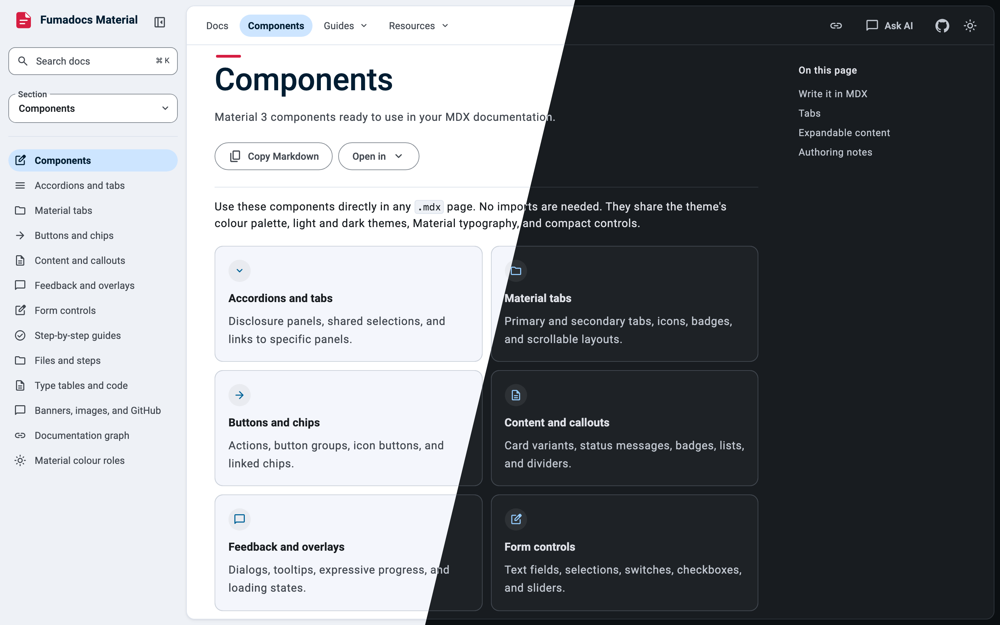
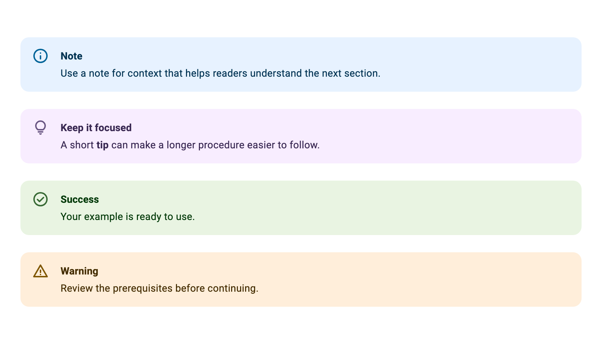
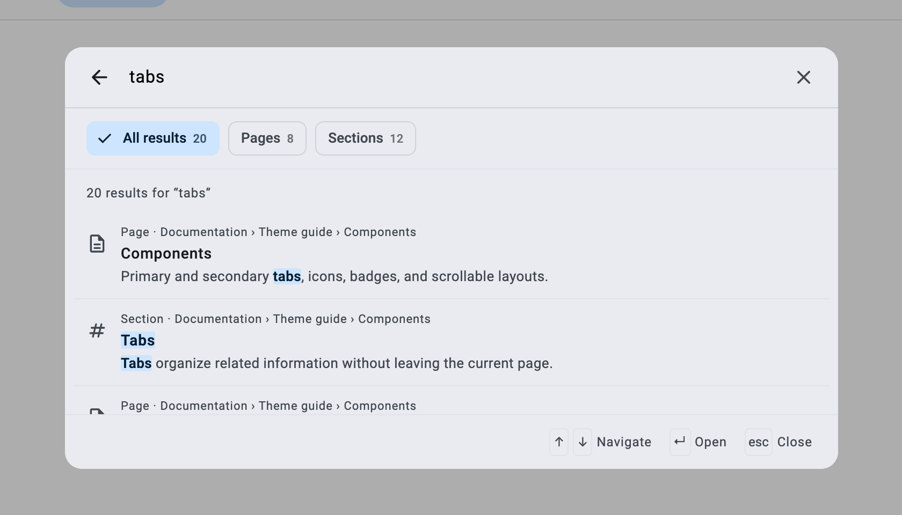
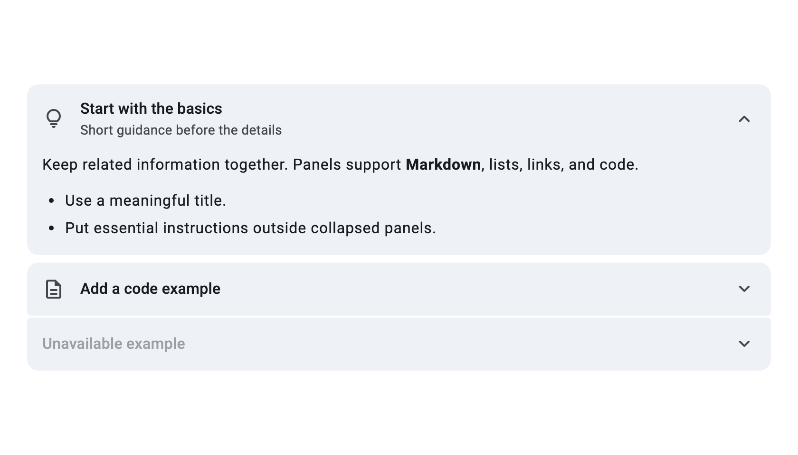
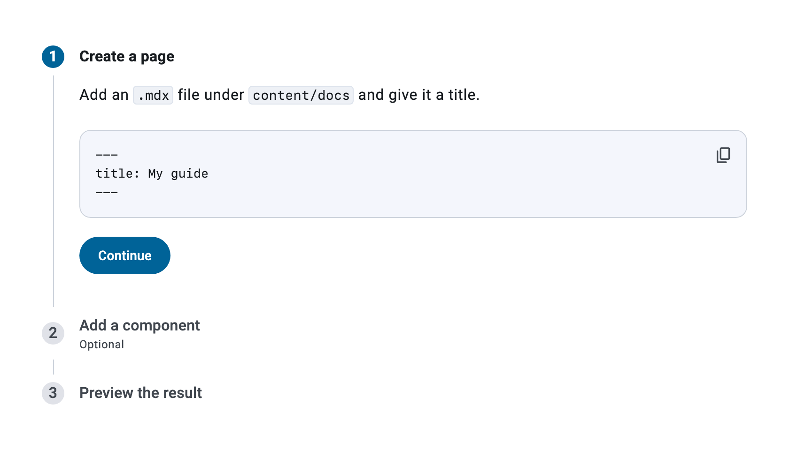
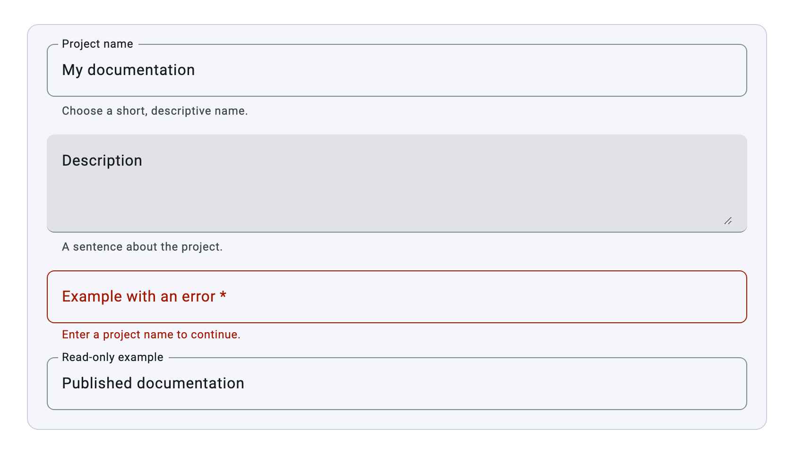
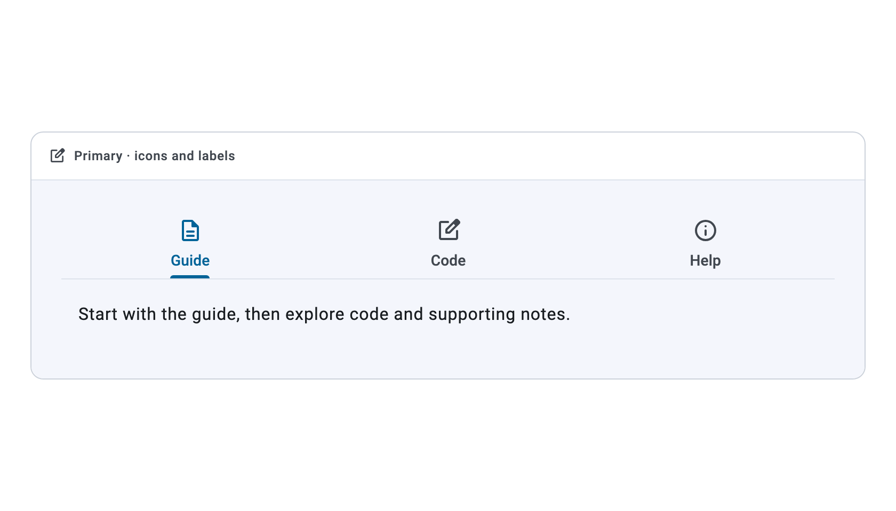
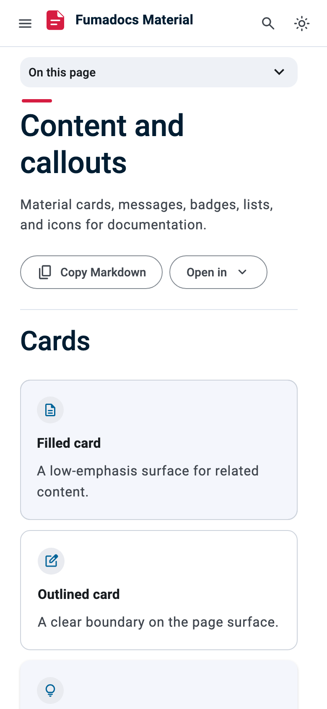
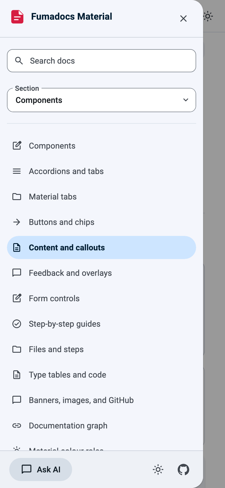

<div align="center">


# Fumadocs Material

**A Material 3 documentation theme for [Fumadocs](https://fumadocs.dev).**<br />
Built on TanStack Start and M3E web components, with light and dark themes and accessible colour.

[](https://fumadocs.dev) [](https://tanstack.com/start) [](https://github.com/matraic/m3e) [](https://bun.sh) [](LICENSE)

[Quick start](#quick-start) · [Features](#features) · [Make it yours](#make-it-yours) · [Writing docs](#writing-docs) · [Contributing](CONTRIBUTING.md)

<br />



</div>

## Features

- 🧭 **Material 3 Expressive shell:** sidebar with section and version pickers, navbar menus, a mobile drawer and a table of contents.
- 🧩 **The full Fumadocs UI catalogue, in Material:** callouts, cards, tabs, accordions, steppers, dialogs, forms, type tables, file trees and more, with no imports needed in MDX.
- 🎨 **Accessible colour:** text meets 4.5:1 and indicators meet 3:1, in both themes.
- 🔎 **Search:** filter by pages or sections and navigate with the keyboard.
- 🗂️ **Versioned docs:** a version picker that keeps you on the matching page.
- ✨ **AI-ready:** an Ask AI chat, `llms.txt`, a Markdown copy of every page and generated Open Graph images.

## Gallery

<table>
  <tr>
    <td width="50%">
      <picture><source media="(prefers-color-scheme: dark)" srcset=".github/assets/callouts-dark.png" /></picture>
      <p align="center"><b>Callouts</b></p>
    </td>
    <td width="50%">
      <picture><source media="(prefers-color-scheme: dark)" srcset=".github/assets/search-dark.png" /></picture>
      <p align="center"><b>Search</b></p>
    </td>
  </tr>
  <tr>
    <td width="50%">
      <picture><source media="(prefers-color-scheme: dark)" srcset=".github/assets/accordion-dark.png" /></picture>
      <p align="center"><b>Accordions</b></p>
    </td>
    <td width="50%">
      <picture><source media="(prefers-color-scheme: dark)" srcset=".github/assets/stepper-dark.png" /></picture>
      <p align="center"><b>Steppers</b></p>
    </td>
  </tr>
  <tr>
    <td width="50%">
      <picture><source media="(prefers-color-scheme: dark)" srcset=".github/assets/forms-dark.png" /></picture>
      <p align="center"><b>Forms</b></p>
    </td>
    <td width="50%">
      <picture><source media="(prefers-color-scheme: dark)" srcset=".github/assets/tabs-dark.png" /></picture>
      <p align="center"><b>Tabs</b></p>
    </td>
  </tr>
  <tr>
    <td colspan="2" align="center">
      <picture><source media="(prefers-color-scheme: dark)" srcset=".github/assets/mobile-page-dark.png" /></picture>
      &nbsp;&nbsp;
      <picture><source media="(prefers-color-scheme: dark)" srcset=".github/assets/mobile-drawer-dark.png" /></picture>
      <p align="center"><b>Phones</b></p>
    </td>
  </tr>
</table>

<sub>Screenshots follow your GitHub theme.</sub>

## Quick start

```bash
gh repo create my-docs --private --template iarata/fumadocs-material --clone
cd my-docs
bun install
bun run dev
```

Or select **Use this template** on GitHub. Use Bun, which applies the M3E fix in `patches/`.

> [!TIP]
> To enable **Ask AI**, copy `.env.example` to `.env.local` and set `OPENROUTER_API_KEY`. Everything else works without it.

| Command | Purpose |
| --- | --- |
| `bun run dev` | Start the development server |
| `bun run build` | Build for production |
| `bun run start` | Preview the production build |
| `bun run types:check` | Type-check |
| `bun run lint` | Lint with oxlint |

## Make it yours

| Change | Where |
| --- | --- |
| Site name and repository | `appName` and `gitConfig` in `src/lib/shared.ts` |
| Logo | `BrandMark` in `src/components/ui/brand-icons.tsx` |
| Colours | `src/styles/theme.css` and `src/styles/color-roles.css` |
| Social images | `src/lib/og.tsx` |
| Navbar links and menus | `src/lib/layout.shared.tsx` |
| Home page | `src/routes/index.tsx` |
| Content | `content/docs` |

The sample pages in `content/docs/test` and `content/docs/versions` show every component and option. Delete them when you no longer need them, then update `content/docs/meta.json` and the navbar links.

> [!IMPORTANT]
> **Colour rules:**
> - Primary marks what is interactive or selected. The accent marks identity only (the logo and the title overline).
> - Text needs 4.5:1 contrast and indicators need 3:1, in both themes.
> - Define every `--md-sys-color-*` role in both theme blocks, because M3E falls back to its baseline purple.

## Writing docs

Components are registered globally, so MDX pages need no imports:

```mdx
<Callout type="tip" title="Ready to use">
  Combine **Markdown** with Material components.
</Callout>

<Button variant="tonal" icon="ArrowRight" href="/docs/test/components">
  Explore components
</Button>
```

<details>
<summary><b>All components</b></summary>

| Group | Components |
| --- | --- |
| Content | `Card`, `Cards`, `Callout`, `Badge`, `List`, `ListItem`, `Divider`, `Icon` |
| Actions | `Button`, `IconButton`, `ButtonGroup`, `Chip`, `Chips` |
| Feedback | `Dialog`, `Tooltip`, `Progress`, `LoadingIndicator`, `Skeleton` |
| Inputs | `TextField`, `TextArea`, `Checkbox`, `Switch`, `RadioGroup`, `Select`, `Slider` |
| Organisation | `Tabs`, `Tab`, `TabsList`, `TabsTrigger`, `TabsContent`, `Accordions`, `Accordion`, `Stepper`, `Steps`, `Step` |
| Documentation | `Files`, `File`, `Folder`, `TypeTable`, `AutoTypeTable`, `InlineTOC`, `CodeBlock`, `Pre`, `DynamicCodeBlock` |
| Media | `ImageZoom`, `Banner`, `GithubInfo`, `GraphView`, `Preview` |

Live examples with copyable MDX are at `/docs/test/components`.

</details>

<details>
<summary><b>Navigation and versions</b></summary>

- `root: true` in a folder's `meta.json` makes it a sidebar section.
- `root: "version"` on sibling folders adds a version picker. Switching versions keeps you on the matching page, or opens the version's index if there isn't one.
- Search is scoped to the active version.
- `DocsLayout` also accepts `tabs`, `tabMode`, `versions`, and navbar and sidebar options. See `/docs/test/layouts`.

</details>

## Project structure

```text
content/docs/            MDX pages and meta.json files
src/components/m3e/      Docs shell: layouts, sidebar, navbar, drawer, search, TOC
src/components/m3e/mdx/  MDX components
src/components/mdx.tsx   MDX component map
src/components/ai/       Ask AI and page actions
src/lib/                 Site config, content source, code theme, OG images
src/routes/              Pages, search, chat, llms.txt and OG image routes
src/styles/              Theme, colour roles, component styles, type scale
patches/                 M3E fix, applied by Bun on install
```

## Contributing

Contributions are welcome. See [CONTRIBUTING.md](CONTRIBUTING.md).

## License

[MIT](LICENSE) © Alireza Hajebrahimi. The bundled Material Symbols icons are under the Apache License 2.0 (`src/components/ui/material-symbols.LICENSE`).

Built with [Fumadocs](https://fumadocs.dev), [TanStack Start](https://tanstack.com/start), [M3E](https://github.com/matraic/m3e) and [Material Design 3](https://m3.material.io).
